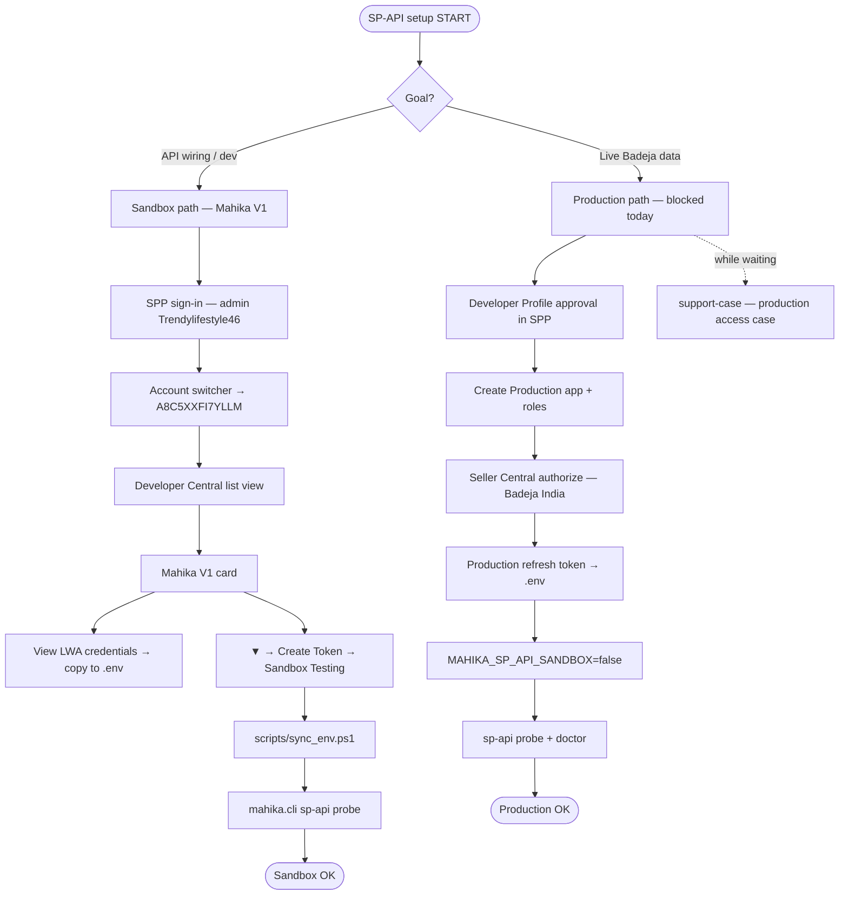

# Mahika SP-API — Setup & Verify Flow

**Project:** Project Alpha (India seller — Badeja Enterprises)  
**Code:** `agent/src/mahika/sp_api/`  
**Checklist:** `agent/scripts/sp_api_registration_checklist.md`  
**Tags (graphify):** `sp-api`, `lwa`, `sandbox`, `production`, `solution-provider-portal`, `badeja-india`, `mahika`

---

## Ho chuka (2026-07-20 verify)

| Item | Status |
|------|--------|
| Sandbox app **Mahika V1** | Exists in Solution Provider Portal |
| LWA Client ID | `amzn1.application-oa2-client.41d65731b4d54099a385d5f780a23cc3` (public — not secret) |
| LWA + sandbox refresh in `.env` | Filled (via `scripts/sync_env.ps1`) |
| LWA token exchange | **PASS** |
| Sandbox Orders API | **PASS** — 2 mock orders (`TEST_CASE_200`) |
| Production Orders/Finances/Reports | **403** — expected until production app + profile approval |
| Developer profile ID | `A8C5XXFI7YLLM` (UI label: **A8C5XXFI7YLLM - United States**) |
| India marketplace | `A21TJRUUN4KGV` · region `eu-west-1` |
| India paid account ID | `amzn1.pa.d.AB5ZXZYCP3XOLA6T5BVNPV2EXP6A` |

### Production app attempt (2026-07-20 — Cursor browser)

| Step | Result |
|------|--------|
| SPP account switcher → **A8C5XXFI7YLLM - United States** | Profile selectable; **Select account** click did not always redirect — use direct Developer Central URL instead |
| Developer Central list | **Empty** — "You currently have no application clients" (migration still in progress) |
| Direct app form | `…/developerconsole/application?mons_sel_dir_paid=amzn1.pa.d.AB5ZXZYCP3XOLA6T5BVNPV2EXP6A` loads **Create your app** |
| App name + API Type | **Mahika V1** + **SP API** — form accepts input |
| App Type → **Production** | **BLOCKED** — radio disabled; tooltip: **"Production app creation requires approval of Developer Profile."** |
| Production Client ID | **Not created** — blocked at profile approval |
| SPP Support → Case Log | Form visible at `solutionproviderportal.amazon.com/support` (iframe `hill/website/form/13691`); Cursor browser cannot auto-fill shadow/iframe — **manual submit or `mahika.cli support-case`** |

**Support case text (SPP Account Related form):** subject `need live seller tools`; paste help text from `mahika/playwright/support_case_text.py` variant 1 — include Developer id `A8C5XXFI7YLLM`, App id `amzn1.sp.solution.8fd7d23a-72d4-4152-a8aa-40654de8c215`, roles needed: Orders, Finances, Reports.

---

## Family tree



---

## Env vars (root `.env` → `scripts/sync_env.ps1`)

```env
MAHIKA_SP_API_LWA_CLIENT_ID=
MAHIKA_SP_API_LWA_CLIENT_SECRET=
MAHIKA_SP_API_REFRESH_TOKEN=
MAHIKA_SP_API_ROLE_ARN=               # empty for private self-authorized seller apps
MAHIKA_SP_API_REGION=eu-west-1
MAHIKA_SP_API_MARKETPLACE_ID=A21TJRUUN4KGV
MAHIKA_SP_API_SANDBOX=true            # false after production refresh token
```

Legacy backend mirrors same LWA values as `BACKEND_AMAZON_*` (see root `.env.example`).

---

## Portal paths (do NOT use Edit App)

| Need | Where |
|------|--------|
| LWA Client ID + Secret | Developer Central **list** → **Mahika V1** → **View LWA credentials** |
| Sandbox refresh token | Same card → **▼** → **Create Token** → **Sandbox Testing** |
| Production refresh token | After profile approval — authorize on Seller Central (Badeja \| India) |
| Roles (Orders, Finances, Reports) | Production app setup — not on sandbox Edit App |
| Create app (when list empty) | Direct: `…/developerconsole/application?mons_sel_dir_paid=amzn1.pa.d.AB5ZXZYCP3XOLA6T5BVNPV2EXP6A` |

**Onboarding (India context):**  
`https://solutionproviderportal.amazon.com/account/program?enrollmentApplicationId=hC8h11s1&mons_sel_dir_paid=amzn1.pa.d.AB5ZXZYCP3XOLA6T5BVNPV2EXP6A`

**Developer Central:**  
`https://solutionproviderportal.amazon.com/sellingpartner/developerconsole`

**Account switcher:** profile **A8C5XXFI7YLLM - United States** (developer profile; API calls still use India marketplace ID).

---

## Commands

```powershell
# Sync root .env → agent/.env
powershell -File scripts\sync_env.ps1

cd agent

# Quick status (no raw secrets printed)
.\.venv\Scripts\python.exe -m mahika.cli sp-api status

# Full probe JSON (sandbox + prod endpoint matrix)
.\.venv\Scripts\python.exe -m mahika.cli sp-api probe

# Doctor check [8/10]
.\.venv\Scripts\python.exe -m mahika.cli doctor
```

**Optional browser harvest (visible window, OTP via Telegram):**

```powershell
cd agent
.\.venv\Scripts\python.exe scripts\sp_api_setup.py
```

Requires `AMAZON_ADMIN_EMAIL` / `AMAZON_ADMIN_PASSWORD` in root `.env`. OTP → phone ending **503** → forward to `@mahika_arun_bot`.

---

## Production unblock (Sir actions)

1. **Submit support case** — SPP Support tab open in browser, or `python -m mahika.cli seller-login` then `support-case --submit` (Developer Profile approval for live Mahika V1; roles: Orders, Finances, Reports).
2. **Wait for SPP migration** — Developer Central list empty today; sandbox Mahika V1 may reappear after migration (~2 h).
3. After profile approval → **Create production app** (same form; Production radio should enable).
4. **Authorize** on Seller Central → **Badeja Enterprises \| India** → copy production refresh token.
5. Set `MAHIKA_SP_API_SANDBOX=false`, re-run `sync_env.ps1`, then `sp-api probe`.

---

## Code map

| Module | Role |
|--------|------|
| `mahika/sp_api/client.py` | LWA + Orders/Reports/Finances factories, `check_status()`, `ping()` |
| `mahika/config.py` | Env vars; sets `AWS_ENV=SANDBOX` when `MAHIKA_SP_API_SANDBOX=true` |
| `mahika/services/refund_watcher.py` | Finances poll (skipped in sandbox) |
| `mahika/services/returns_scanner.py` | Returns poll (skipped in sandbox) |
| `scripts/sp_api_probe.py` | Legacy probe — prefer `mahika.cli sp-api probe` |

---

## Related flows

| Flow | When |
|------|------|
| [create-seller-support-case/](../create-seller-support-case/FLOW.md) | Production SP-API approval case |
| [seller-central-login/](../seller-central-login/FLOW.md) | Seller Central session (reports lane; not SP-API auth) |
| [seller-reports/](../seller-reports/GUIDE.md) | CSV reports without SP-API |
